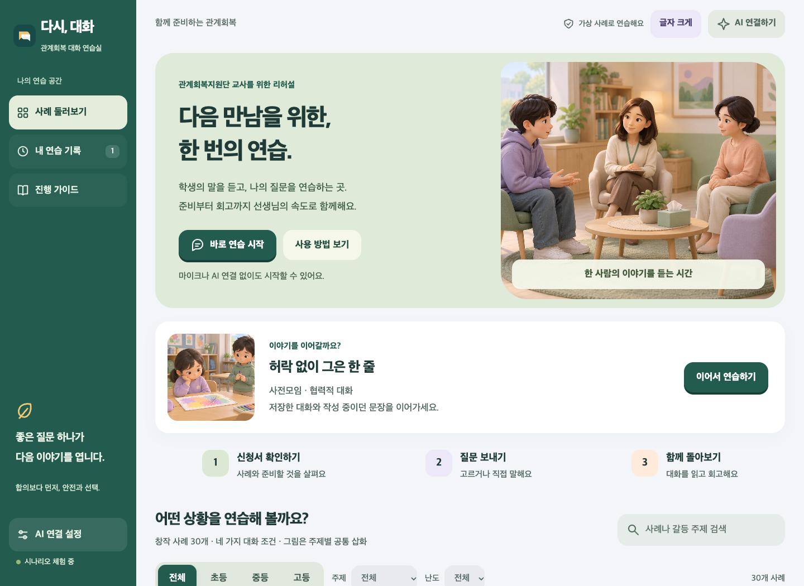

# 다시, 대화 · v0.2.1

충남 관계회복지원단 교사가 가상 학생·보호자와 대화모임을 연습하는 웹앱입니다. 충남 관계회복 운영 자료를 참고했습니다. [자료와 적용 범위](docs/SOURCES.md)에 참고 링크를 정리했습니다. 학교급별 창작 사례 30개를 제공합니다.



## 웹 배포

**[공개 앱 열기](https://dasi-dialogue.vercel.app)** — PC와 휴대전화에서 설치 없이 사용할 수 있습니다.

GitHub `main`에 푸시하면 같은 공개 주소가 자동 갱신됩니다. Vercel에서 저장소를 연결하면 `vercel.json`에 따라 `public/` 화면과 Node.js API 함수가 함께 배포됩니다. Node.js 24를 사용하며 별도 빌드나 패키지 설치가 필요하지 않습니다. 사용자는 화면에서 자신의 API 키를 입력하므로 서버 환경 변수에 공용 AI 키를 등록하지 않습니다. 서버는 요청 본문이나 API 키를 로그로 남기지 않습니다.

HTTPS 주소에서 마이크 권한을 허용할 수 있습니다. 공개 주소·로컬 주소·다른 브라우저의 기록은 서로 공유되지 않습니다.

## 실행하기

Node.js 22 이상이 있으면 추가 패키지 설치 없이 실행됩니다. macOS·Windows·Linux에서 사용할 수 있습니다. Node.js 22·24의 자동 검사와 macOS Chrome의 화면 검사를 제공합니다.

1. 저장소를 내려받고 Cursor에서 **파일 → 폴더 열기**로 `dasi-dialogue` 폴더를 엽니다.

   ```sh
   git clone https://github.com/doguri25/dasi-dialogue.git
   cd dasi-dialogue
   ```

2. **터미널 → 새 터미널**에서 실행합니다.

   ```sh
   npm start
   ```

3. Chrome에서 [http://localhost:3210](http://localhost:3210)을 엽니다. 터미널은 켜 둡니다. 종료할 때는 터미널에서 `Control+C`를 누릅니다.

Finder에서 `다시대화 실행.command`를 더블클릭해 서버를 시작할 수도 있습니다. 같은 포트에서 이미 실행 중이라면 기존 브라우저 주소를 열면 됩니다. 파일을 `file://`로 직접 열지 마세요.


## v0.2에서 달라진 점

- 첫 화면에서 진행 중이거나 저장한 연습을 바로 이어갑니다. 검색 조건도 한 번에 초기화합니다.
- 대화 상대·단계별 초안, 발문 방식, 선택한 질문이 수동 저장·재개에 포함됩니다. API 키는 저장하지 않습니다.
- 다음 모임에 필요한 확인 항목과 기록을 안내합니다. 모바일의 **진행 확인 열기**로 바로 이동할 수 있습니다.
- 대화 중 **전체 대화**에서 지난 단계까지 읽습니다. 교사용 기록 보기이며 학생 역할 AI의 사전면담 격리는 유지됩니다.
- 회고에서 실제 교사 질문을 참고 장면으로 살펴봅니다. 내려받는 Markdown에 현재 회고와 참고 장면도 포함됩니다.
- 시작·대화·회고 화면의 큰 색 면, 간격, 버튼, 글자와 모바일 배치를 다듬었습니다.

[PRD 적용표](docs/PRD-COVERAGE.md) · [변경 기록](CHANGELOG.md) · [검증 기록](docs/VERIFICATION.md)

## 첫 연습

1. 사례와 대화 조건을 고릅니다. **협력적 대화 / 방어와 교착 / 중단이 필요한 순간 / 사후 약속 미이행** 중 선택합니다.
2. **신청서 확인**에서 배경·학생별 어려움·동의 서류·안전 우려를 읽고 **사전모임 시작하기**를 누릅니다. 체크리스트나 진행 방향 선택 없이 바로 이동합니다.
3. 사전모임은 **대화모임 안내 → 무슨 일이 있었는지 듣기** 순서입니다. 안내 고르기의 문장을 보내거나 직접 입력·마이크로 모임을 설명합니다. 답변을 받으면 이야기 듣기 질문이 나타납니다. 학생별·보호자별로 안내 순서를 따로 기억하며, 다른 사람의 사전 발언은 공유하지 않습니다.
4. 기본 화면의 **질문 고르기**에서 발문 4개 중 하나를 선택하고 **선택한 질문 보내기**를 누릅니다. **다른 질문 보기**로 추가 4개를 볼 수 있습니다. 학생·보호자 답변이 오면 그 내용에 이어지는 선택지 4개로 바뀝니다. AI 모드에서는 같은 요청에서 다음 발문까지 생성하며, 선택지가 없거나 시나리오 체험이면 직전 발언을 참고한 질문 예시를 제공합니다. 다른 질문 보기에는 단계·상대·연습 조건에 맞는 기본 질문이 나옵니다. **문장 고쳐 쓰기**로 선택한 문장을 수정할 수도 있습니다.
5. 직접 확인한 참여 의사·안전 항목을 표시하고 본모임으로 이동합니다. 대면 준비가 되지 않았다면 언제든 모임을 마치고 보류·중단을 회고할 수 있습니다.
6. 본모임에서 합의 또는 미합의 내용과 점검 계획을 적고 사후모임에서 실천·미이행·안전을 확인합니다.
7. 종료 후 회고합니다. **기록 저장**을 누른 기록만 현재 브라우저에 남습니다. 기록 재개·삭제와 Markdown 내려받기를 지원합니다. 작성 중인 문장·발문 방식·선택한 질문도 함께 저장되며 첫 화면의 **이어서 연습하기**에서 복원됩니다. 초안은 학생·단계별로 분리됩니다.

사전면담 참여 의사를 확인했다는 체크 자체가 참여 동의를 뜻하지 않습니다. 학생이 거절한 상태라면 본모임으로 진행하지 말고 보류·개별 지원을 연습하세요. 결과는 진행자가 기록하며 앱이 실제 사안의 성공·실패를 판정하지 않습니다.

발문 방법은 언제든 **질문 고르기 / 직접 입력·마이크** 사이에서 바꿀 수 있습니다. 직접 쓰던 문장은 방법을 바꿨다가 돌아와도 유지됩니다. 마이크를 사용할 때는 인식이 끝난 문장을 확인·수정한 뒤 **보내기**를 누릅니다. 객관식 선택과 음성 인식만으로 자동 전송하지 않습니다. 객관식 발문은 정답을 채점하는 시험이 아니라 진행자가 질문의 방향을 고르는 연습입니다.

## 학생 이미지와 신청서 열람

학생 캐릭터 **6명**(초·중·고 각 2명)과 갈등 주제 삽화 **7장**을 생성해 포함했습니다. 사례 카드·상세 화면·신청서·대화 말풍선에서 볼 수 있습니다. 캐릭터와 삽화는 여러 사례에 공통으로 사용하며 실제 학생이나 사건을 묘사하지 않습니다. 이미지 원본 PNG와 화면용 WebP는 `public/assets/`, 제작 프롬프트와 생성 파일명 대응은 [image-assets.json](docs/image-assets.json)에 있습니다.

신청서는 30개 가상 사례와 선택한 조건을 바탕으로 제공하는 연습 자료입니다. 공식 서식 복제나 실제 신청 접수·발송 기능은 아닙니다. 읽은 뒤 버튼 하나로 모든 조건의 사전모임에 바로 들어갑니다. 동의 서류 누락이나 의사 변경은 문서에 표시하고 사전 대화에서 살펴봅니다.

사전모임은 학생이 사건부터 말하는 대신 진행자의 안내를 기다리며 시작합니다. **안내 고르기** 4개 중 하나를 보내거나 직접 설명하면, **무슨 일이 있었는지 이야기하기** 질문 4개로 바뀝니다. 각 순서에서 다른 문장 4개도 볼 수 있습니다. 안내를 들었다는 반응을 대면 동의로 처리하지 않으며 기존 본모임의 참여 의사·안전 확인은 별도로 남습니다. 거절 조건에서는 본모임으로 전환하지 않습니다.

신청서를 읽었다는 기록과 학생별 진행 순서는 **기록 저장**으로 보관합니다. 이전 버전의 검토 메모·보류 기록도 지우지 않고 다시 볼 수 있으며, 검토 선택이 사전모임 진입을 막지 않습니다. 전송 실패 때는 안내 단계와 선택 문장을 유지합니다.

PC와 모바일 모두 신청서를 한 화면 흐름으로 읽습니다. 문서 위·아래에 사전모임 시작 버튼을 두었습니다. 사전모임의 안내와 이야기 듣기 순서는 큰 색 면으로 표시합니다.

## PC·모바일 화면과 큰 글자

- **PC:** 왼쪽 메뉴, 가운데 대화·질문, 오른쪽 진행 확인·약속 메모를 함께 봅니다.
- **모바일·태블릿:** 아래의 **사례 / 연습 / 기록 / 도움말**로 이동합니다. 연습 화면에서 **대화 연습 / 진행 확인**을 바꿔 보며, 확인을 마치고 다음 단계로 이동하면 대화 화면으로 돌아옵니다. 화면을 바꿔도 선택한 질문과 작성 중인 문장은 유지됩니다. 질문을 고르면 대화창으로 이동하며, 바로 아래의 **이 문장 보내기**를 눌러 전송합니다. 긴 문장은 **문장 전체 보기**로 펼칩니다. 답변이 도착하면 대화창에서 최신 발언을 볼 수 있습니다.
- 기본 본문 18px, 대화 약 19px, 주요 전송 버튼 높이 54–58px입니다. 위쪽 **글자 크게**를 누르면 더 크게 읽을 수 있고 이 선택은 브라우저에 기억됩니다. **기본 글자**로 되돌릴 수 있습니다.
- 질문·버튼은 색이 채워진 면으로 구별합니다. 선택한 질문에는 **선택됨**, 확인한 항목에는 **확인함**을 함께 표시합니다.
- 화면 이동·새로운 응답·창 열기에 짧은 움직임을 사용합니다. 기기에서 **동작 줄이기**를 설정하면 이 움직임을 줄입니다.

900px 이하에서 모바일 구성을 사용합니다. 공개 HTTPS 주소는 휴대전화에서도 열 수 있습니다. 로컬 실행 주소는 실행 중인 컴퓨터 안에서만 접속됩니다. 현재 모바일 검증은 브라우저의 모바일 화면 크기로 진행했습니다.

## Claude · Gemini · ChatGPT(OpenAI) 연결

1. 오른쪽 위 **AI 연결하기** 또는 왼쪽 **AI 연결 설정**을 엽니다.
2. **AI 역할 대화**를 선택하고 서비스를 고릅니다.
3. 본인 계정에서 발급한 **API 키**를 입력합니다. 웹 로그인 비밀번호를 넣는 칸이 아닙니다.
4. 필요하면 계정에서 사용할 수 있는 모델명으로 바꿉니다.
5. **연결 확인**을 누른 뒤 **설정 적용**을 누릅니다. 연결 확인도 짧은 API 요청을 보냅니다. 일시적인 서비스 오류에는 한 번 자동 재시도합니다.

| 서비스 | API 키 관리 | 기본 모델 |
| --- | --- | --- |
| Claude | [Claude Console](https://console.anthropic.com/) | `claude-sonnet-4-6` |
| Gemini | [Google AI Studio](https://aistudio.google.com/apikey) | `gemini-3.8-flash` |
| ChatGPT · OpenAI | [OpenAI API Keys](https://platform.openai.com/api-keys) | `gpt-5.4-mini` |

API 키는 현재 창의 메모리와 요청을 처리하는 앱 서버에서만 사용합니다. 파일·브라우저 저장소·기록 내려받기·서버 로그에는 저장하지 않습니다. 새로고침하거나 창을 닫으면 다시 입력해야 합니다. 서비스를 바꾸면 새 서비스의 키를 입력합니다. ChatGPT·Claude·Gemini 웹 구독과 API 이용은 별도입니다.

API를 켜면 선택한 제공사로 가상 사례, 필요한 대화 문맥과 합의가 전송됩니다. **AI 심층 회고**는 전체 연습 대화를 전송합니다. 실제 학생의 실명이나 개인 사안을 입력할 필요는 없습니다. 키 없이 시작하는 **시나리오 체험**은 단어에 따른 준비된 응답이며 자유 대화 AI가 아닙니다. API 오류가 나면 입력 문장을 복구하고 오류를 보여 줍니다.

오류에는 서비스 이름과 원래 HTTP 번호가 표시됩니다. 401은 키 인증, 402는 결제·잔액, 403은 권한, 404는 모델명, 429는 요청·사용량 한도를 확인하세요. 제공사가 결제·할당량 오류로 구분해 알려준 경우에는 해당 안내가 표시됩니다. 500·502·503·504·529의 일시 오류는 전체 60초 한도 안에서 한 번 재시도합니다. 제공사가 3초보다 긴 대기를 요구하거나 남은 시간이 적으면 바로 오류를 안내합니다. 키·결제·한도 오류는 자동 재요청하지 않습니다. 오류 원문과 키는 표시하거나 기록하지 않고, 고른 문장과 직접 입력한 글은 유지합니다.

## 음성 입력과 기록

- 마이크 권한을 허용하고 한국어로 말합니다. 인식 중에는 직접 입력이 잠깐 잠기며 **인식 마치기** 후 수정할 수 있습니다.
- 브라우저의 SpeechRecognition 기능을 사용합니다. Chrome에서도 운영체제·언어·네트워크에 따라 이용이 제한될 수 있습니다. 지원되지 않으면 텍스트 입력을 사용합니다.
- 이 앱은 음성 파일을 저장하지 않습니다. 브라우저의 인식 서비스로 음성이 전송될 수 있습니다. **답변 읽어주기**는 설치된 한국어 음성에 따라 다르게 들립니다.
- 기록은 자동 저장되지 않습니다. **아직 저장하지 않았어요 / 저장 후 바뀐 내용이 있어요 / 이 브라우저에 저장했어요** 표시로 현재 상태를 확인합니다. **기록 저장**을 누르면 현재 브라우저의 localStorage에 최신 20개까지 보관합니다. 다른 컴퓨터와 동기화하지 않습니다.
- `localhost`와 `127.0.0.1`은 서로 다른 브라우저 저장소입니다. 기록을 계속 보려면 같은 주소를 사용하세요. 브라우저 데이터 삭제·시크릿 창 종료 시 기록이 사라질 수 있어 필요하면 내려받으세요.

## 개발과 검증

```sh
npm test
```

Node 기본 테스트는 시나리오 분기·단계 조건·개별면담 분리·AI 응답 검증·각 제공사 요청 형식과 로컬 HTTP 서버를 검사합니다. 실제 API 키를 사용하지 않습니다.

브라우저 검사는 Playwright와 Chrome이 있는 개발 환경에서 실행합니다. 앱 실행에는 필요하지 않습니다.

```sh
PLAYWRIGHT_MODULE=/absolute/path/to/playwright/index.mjs node tests/browser.mjs
```

신청서에서 사전모임 안내·이야기로 이어지는 흐름은 같은 환경에서 `node tests/intake-browser.mjs`로 검사합니다.

기기별 화면·글자 확대·모바일 진행·동작 줄이기는 같은 환경에서 `node tests/responsive.mjs`로 검사합니다.

v0.2의 초안·선택 복원, 준비 상태, 전체 대화, 회고 내보내기는 `node tests/v02-browser.mjs`로 검사합니다.

학생 답변별 선택지와 모바일 선택·전송·오류 후 복구는 `node tests/followups-browser.mjs`로 검사합니다.

공개 배포의 HTTP 경로는 `TEST_URL=https://dasi-dialogue.vercel.app node tests/hosting-live.mjs`로 검사합니다. 유효한 API 키나 유료 호출 없이 화면·이미지·API 입력 검증을 확인합니다. 브라우저 검사에도 같은 `TEST_URL`을 지정할 수 있습니다.

테스트가 만드는 `.test-artifacts/`는 개발용 스크린샷·검증 기록이며 배포 파일에 포함하지 않습니다. 브라우저 검사도 가짜 API 응답과 음성 인식 모의 객체를 사용하므로 실제 API 계정별 접근과 물리 마이크 동작을 검증한 것은 아닙니다.

`public/`은 UI와 사례·체험 분기, `lib/`은 제공사 호출과 역할 문맥, `server.mjs`는 루프백 HTTP 서버입니다. 요청 호스트·동일 출처를 검사하고 키는 고정된 제공사 API 주소로만 전달합니다. 공개 배포에서는 `api/[action].js`가 동일한 API 처리기를 사용합니다. 로그인·기록 동기화 기능은 포함하지 않습니다. 자세한 범위는 [PRD](docs/PRD.md)에 있습니다.

## 근거와 API 문서

운영 참고는 [2026 충남 신청서식](https://talkcne.or.kr/bbs/board.php?bo_table=notice&wr_id=102), [관계회복지원단 안내](https://talkcne.or.kr/bbs/board.php?bo_table=notice&wr_id=81), [보관된 2026 길라잡이](https://drive.google.com/file/d/1ONfMRtLMJSnKZW4F-Ff4NSQOqHpuvF6A/view)입니다. 실제 확인 범위와 읽지 못한 첨부파일은 [자료와 적용 범위](docs/SOURCES.md)에 정리했습니다. 사례·대사는 창작이며 공식 공인 대본이나 역량 인증이 아닙니다.

연결 구현은 [Claude Messages](https://platform.claude.com/docs/en/api/messages/create), [OpenAI Responses](https://developers.openai.com/api/reference/resources/responses/methods/create), [Gemini generateContent](https://ai.google.dev/gemini-api/docs/text-generation), [SpeechRecognition](https://developer.mozilla.org/en-US/docs/Web/API/SpeechRecognition) 문서를 참고했습니다. 기본 모델은 [Claude Sonnet 4.6](https://platform.claude.com/docs/en/models/sonnet-4-6/overview), [Gemini 모델](https://ai.google.dev/gemini-api/docs/latest-model?hl=en), [GPT-5.4 mini](https://developers.openai.com/api/docs/models/gpt-5.4-mini) 문서에서 2026-10-10 확인했으며 설정에서 변경할 수 있습니다.

오류 처리 참고: [Claude API errors](https://platform.claude.com/docs/en/api/errors), [Gemini API troubleshooting](https://ai.google.dev/gemini-api/docs/troubleshooting).
